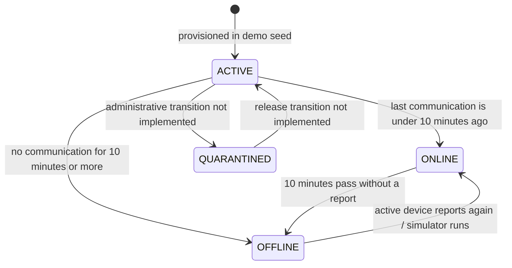
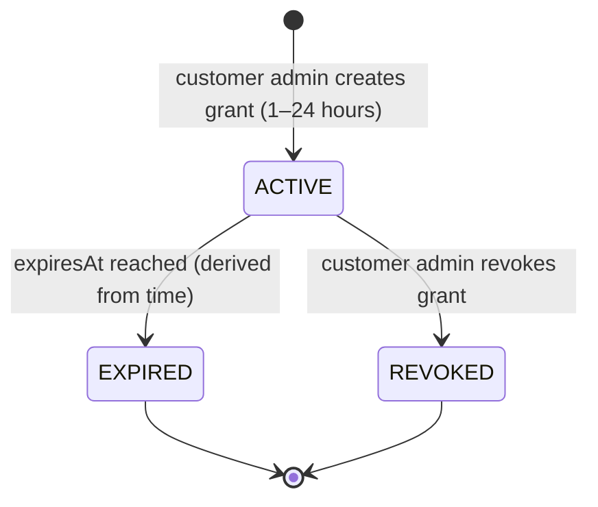
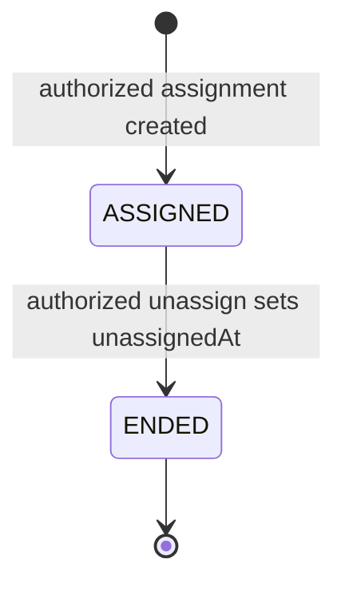
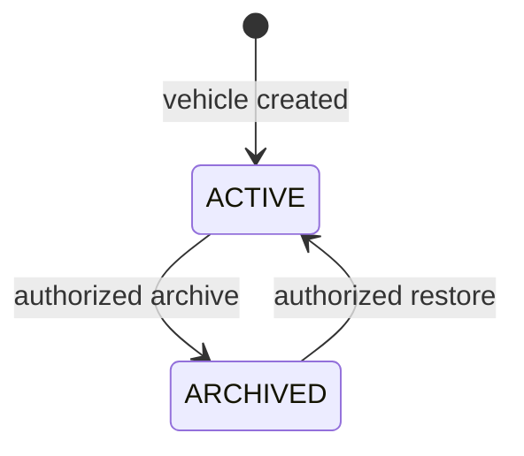
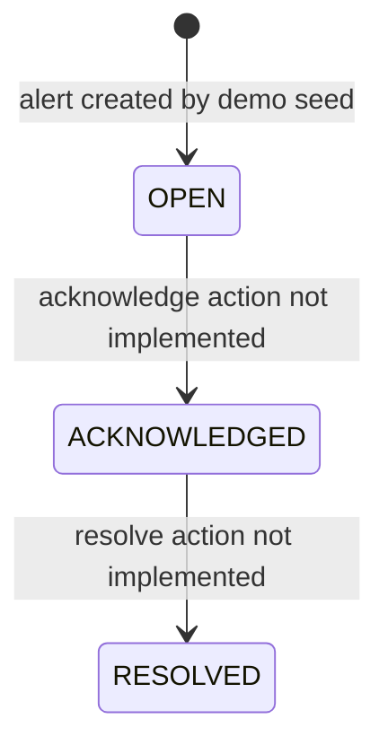
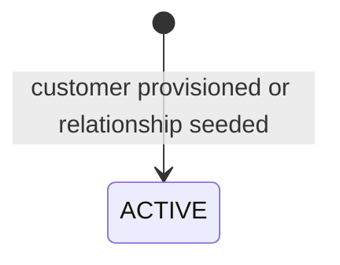
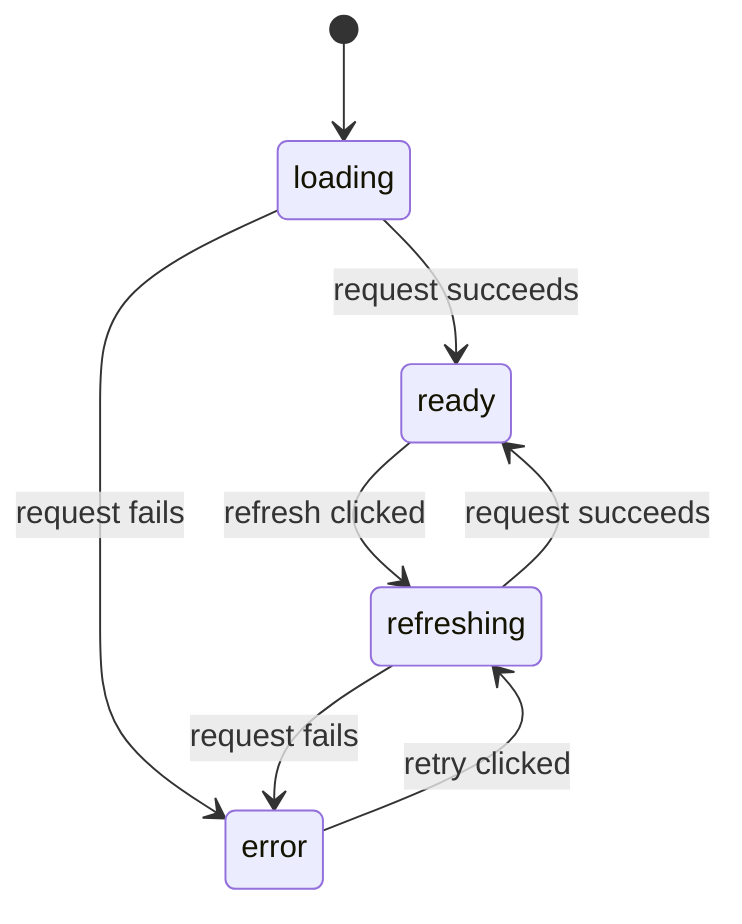

# Sentinel Fleet — Safe Local MVP

A runnable multi-tenant GPS fleet-tracking demonstrator: a customer/reseller portal, a physically
separate platform-admin console, and a policy-enforced API. This is a local MVP, not a production
telematics service.

## Quick start

Requirements: Node.js 24+ and npm. Docker is optional.

```bash
npm install
npm start
```

`npm start` and `npm run dev` both check the PostgreSQL address from `.env`. If it is reachable, the API uses it; if
not, development automatically continues with a clean in-memory SQLite database. Use `npm run dev:sqlite`
when demo changes should persist in `.data/sentinel.sqlite`. Open:

- Portal: `http://localhost:5173`
- Admin: `http://localhost:5174`
- GPS device simulator: `http://localhost:5175`
- Simulator control service: `http://localhost:5176`
- API health: `http://localhost:8787/api/health`
- Coban TCP/UDP gateway: `localhost:8090`

Use `Control-C` to stop all four processes. To require a specific database:

```bash
npm run dev:sqlite                         # no Docker or server required
docker compose up -d --wait db
npm run dev:postgres                       # fails clearly if PostgreSQL is unavailable
```

Verify a change with `npm test && npm run build`. AI coding agents should read
[`AGENTS.md`](AGENTS.md) before editing; product and privacy constraints are in
[`DECISIONS.md`](DECISIONS.md).

## Project in one minute

| Part | Purpose | Main boundary |
| --- | --- | --- |
| Portal | Customer fleet views and reseller support | Resellers need a service relationship; coordinates also require a live grant |
| Admin | Platform operations and aggregate health | Separate app/API; never returns coordinates |
| Device simulator | Multi-session Coban 303FG operations console | Isolated lab UI; sends raw GPS103 TCP/UDP to the gateway |
| API | Authorization, fleet data, telemetry simulation, audit | Tenant checks happen server-side on every request |
| Database | Seeded demo organizations, vehicles, devices and grants | PostgreSQL or local SQLite through Sequelize |

The device lab is isolated from the customer and admin interfaces. Simulated relay actions are
clearly marked and do not enable remote immobilization in either fleet UI.

## Application structure

```text
src/apps/portal/   Customer and reseller React + TypeScript portal   (PORTAL_PORT, default 5173)
src/apps/admin/    Isolated platform-admin React + TypeScript console (ADMIN_PORT,  default 5174)
src/apps/device-simulator/ Full-screen Coban tracker lab             (SIMULATOR_PORT, default 5175)
src/apps/api/      Express 5 + TypeScript + Sequelize API             (API_PORT,    default 8787)
src/packages/ui/   Shared React UI components and the portal design system
```

The portal and admin remain separate applications, but both use `@sentinel/ui` from
`src/packages/ui/` for common presentation components and styling. The admin uses the portal's visual
system while keeping its own navigation, API surface, and platform-only data boundary.

Every port is configured in `.env` (`API_PORT`, `PORTAL_PORT`, `ADMIN_PORT`, `SIMULATOR_PORT`,
`SIMULATOR_CONTROL_PORT`, `TELEMATICS_PORT`, plus `WEB_HOST` for the Vite dev servers).

The Playwright and onboarding recorders use a separate temporary stack so they cannot collide with
normal development: portal `15173`, admin `15174`, simulator `15175`, simulator control `15176`, API
`18787`, and telematics gateway `18090`. Those processes exist only while the command is running and
are stopped automatically afterward.

## Project skills

Reusable Codex instructions are versioned with the repository under [`skills/`](skills/):

- [`sentinel-e2e`](skills/sentinel-e2e/SKILL.md) maintains the fast, deterministic Playwright journeys.
- [`sentinel-onboarding-media`](skills/sentinel-onboarding-media/SKILL.md) maintains the local Kokoro
  narration and high-quality onboarding-video pipeline.

These project skills contain repository-specific decisions. Global Codex/system skills and external
third-party skills are not copied into this repository.

## Coban 303FG device lab

The isolated full-screen simulator connects directly to the local TCP/UDP gateway or to an ngrok
TCP endpoint. It sends login, heartbeat, location, ACC/state changes, and every documented alarm
family. Its SMS console implements the documented device command vocabulary with simulated
acknowledgements. Light and dark themes are included.

```bash
# Terminal 1: start the complete local stack (PostgreSQL when available, otherwise SQLite)
npm start

# Terminal 2: reuse the existing ngrok TCP endpoint or start one when absent
npm run tunnel:tcp

# Terminal 3, or after an existing tunnel was reused: print endpoint and tracker SMS commands
npm run tunnel:status
```

`npm run tunnel:tcp` checks ngrok's local agent API at `127.0.0.1:4040`. If a TCP tunnel already
forwards to `TELEMATICS_PORT` (`8090` by default), it prints and reuses that endpoint. Otherwise it
starts `ngrok tcp 8090` and remains attached to the terminal; use `Control-C` to close the public
endpoint. Run `npm run tunnel:check` to perform the same check without starting ngrok.

The public hardware path is `Coban tracker -> public ngrok TCP hostname:port -> ngrok agent on this
Mac -> localhost:8090 -> Sentinel telematics gateway -> database and portal`. `npm run tunnel:status`
reads the active endpoint and prints the ordered `begin`, APN, GPRS, TCP, server, interval, and status
SMS commands. The randomly assigned public hostname/port can change after ngrok restarts unless the
account uses a reserved TCP address, so rerun the status command before programming a tracker.

ngrok must be installed and authenticated once with `ngrok config add-authtoken <token>`. Public TCP
endpoints may require account verification or a valid payment method even on a free plan. The tunnel
exposes only raw TCP traffic to the telematics port; it does not publish the portal, admin, or API web
ports. ngrok does not forward UDP, so UDP hardware testing requires a UDP-capable relay, VPN, or
router port-forward.

For simulator-only testing, open `http://localhost:5175`. Connect directly to `localhost:8090`, or
enter the ngrok hostname and port to exercise the same public TCP path as physical hardware.

Each browser session receives isolated device state, traffic history, transport socket, and route.
The first four concurrent sessions map to the four seeded customer vehicles and use IMEIs
`358123049582103` through `358123049582106`, so their movement can be watched together on the
portal's live map.

The Route view accepts an address or `latitude, longitude` pair for both endpoints. It uses the
public Nominatim service for address lookup and OSRM's fastest driving route for geometry and ETA.
Playback defaults to `1x`, so simulated movement takes the route's estimated real travel time;
`10x` and `60x` are available for test runs. The public OpenStreetMap services are rate-limited
development dependencies, not a production routing SLA.

The admin console is not a role-hidden page inside the portal. It is a separate build, entry point, navigation system, development server, and API surface. Its platform overview returns operational aggregates and deliberately omits coordinates.

## Included

- Customer, reseller, and platform organizations with scoped memberships.
- Explicit reseller-to-customer service relationships.
- Customer-owned vehicles and historical device assignments.
- Audited device-assignment list/create/end APIs for customer fleet managers and explicitly
  delegated resellers. A device and vehicle must share the same customer custody/ownership scope;
  assignment authority never grants location access.
- Customer vehicle creation with car, van, truck, motorcycle, scooter, bicycle, bus, and utility types plus persisted map-marker style, color, and size choices. Reseller admins can create the same customer-owned metadata only when both the reseller entitlement and the exact active customer relationship delegate `FLEET_MANAGE`; creation never grants location access.
- Audited vehicle metadata editing and reversible archive/restore lifecycle for customer fleet managers and explicitly delegated reseller admins. Archived vehicles leave active dashboards while assignments, telemetry, alerts, grants, and audit history remain intact.
- Policy-filtered operational health and location data.
- Time-limited, revocable reseller location grants.
- Audit records for cross-tenant location views (`LOCATION_VIEWED`), so a customer can see when a reseller or platform actor received coordinates. Owning-organization member views are not logged to keep the trail meaningful.
- Telemetry simulation with immutable event records and a mutable latest-position projection.
- Persisted decoded vehicle state, five-minute stop-based trip segmentation, and trip paths capped at 100 sampled points per trip.
- Customer-account log-retention policies for 1 month, 6 months, 1 year, and 5 years, with capacity estimates and daily eviction of expired raw messages and telemetry events. Trips and compact trip paths are retained independently.
- A vehicle detail workspace with Current state, Trips, Logs, and Device controls tabs. Logs remain queryable while a tracker is offline and follow the vehicle across historical device assignments.
- An admin Device documentation catalog with protocol/message/command tables and audited per-reseller device-family availability. The checked-in reference starts at [`docs/devices/README.md`](docs/devices/README.md); only Coban GPS103/GPS303 is runtime-supported today.
- Alerts, device inventory, and audit history.
- Cross-tenant policy and HTTP integration tests.
- Express 5 API organized into routes, controllers, services, middleware, database connection/seed files, and Sequelize models.
- PostgreSQL 18 with versioned Umzug migrations as the default database; SQLite remains available as an offline fallback.
- Explicitly disabled remote immobilization.

## Statuses and state machines

These are the statuses represented by the current API, data model, and interfaces. Most status
columns are plain strings, not database enums. The diagrams describe implemented behavior; a
transition marked as unavailable has no API or UI action in this MVP.

### Device and connectivity

`Device.status` stores `ACTIVE` or `QUARANTINED` in the seeded data. `ONLINE` and `OFFLINE` are
computed for display and are not stored: an active device is online when it last communicated less
than 10 minutes ago. An active device outside that window is offline. A quarantined device remains
quarantined regardless of communication time. The local telemetry simulator refreshes the
communication time for active devices, so it can make an offline device appear online again.



The arrows to and from `QUARANTINED` show possible lifecycle concepts only; there is no device
provisioning, quarantine, or release endpoint. `GOOD`, `FAIR`, and `UNKNOWN` are signal-quality
labels, not device lifecycle states. The simulator sets signal quality to `GOOD` when it accepts a
report.

Inbound login, heartbeat, location, alarm, and response frames all update the device's last
communication time. The portal refreshes dashboard connectivity periodically and the vehicle detail
workspace polls its state, so an inactive tracker does not remain visually online indefinitely.

### Vehicle state, trips, and logs

Valid Coban position packets update both `LatestPosition` and `VehicleState`. The state projection
stores ignition, door, external-power, armed, immobilized, fuel, raw status mask, and update time.
Packets without a valid GPS fix may refresh device/state health but do not overwrite the last trusted
coordinates.

A trip starts when speed exceeds 2 km/h. A stationary interval shorter than five minutes remains part
of the same trip; five minutes or more closes the trip at the first stationary point, and later
movement starts another trip. Every trip retains its start/end summary and at most 100 sampled
`TripPoint` rows. The permanent points preserve the first/latest positions and enough intermediate
shape to draw the trip without retaining every raw GPS event.

Raw protocol traffic is stored in `device_message_logs`. The vehicle Logs tab queries persisted rows,
not only the live socket session, and includes historical device assignments. Its human-readable
location view decodes coordinates, speed, heading, fix quality, fuel sensor, ignition, security,
relay, external power, door state, and the raw status mask.

### Location access grants

Grants have no stored `status` field. Access is effective only while `revokedAt` is empty and
`expiresAt` is in the future. Time passing makes a grant expired without a database write; customer
privacy administrators can revoke an unrevoked grant, which sets `revokedAt`. A revoked grant does
not become active again.



Only `ACTIVE` grants authorize the reseller's current-location access. Expired and revoked grants
remain in the customer's grant history.

### Device assignments

An assignment is active when `unassignedAt` is empty. Authorized customer fleet managers and
explicitly delegated reseller device managers can list history, create an assignment, and end it
through `/api/device-assignments`. Setting `unassignedAt` ends the record without deleting it.
Database constraints prevent a device or vehicle from having more than one active assignment, and
the device custody organization must match the vehicle owner organization.



### Vehicles

Vehicles are active while `archivedAt` is empty. Archiving records a timestamp and removes the
vehicle from default dashboards, operational counts, and telemetry simulation without deleting
the vehicle or any related assignment, telemetry, alert, grant, or audit record. Restoring clears
`archivedAt` and returns the vehicle to active views with its history intact. Metadata edits and
both lifecycle transitions are audited.



### Alerts

Seeded alerts use `OPEN` and `ACKNOWLEDGED`. `OPEN` contributes to open-alert counts;
`ACKNOWLEDGED` is shown as an acknowledged alert and no longer counts as open. `RESOLVED` is
recognized by the admin status styling but is not currently produced by the seed or a transition
endpoint. Alerts are listed read-only, so acknowledging and resolving are not currently available
actions.



Alert severity is separate from alert status: seeded severities are `MEDIUM`, `HIGH`, and
`CRITICAL`; severity describes priority and does not move through a lifecycle.

### Service relationships

`ACTIVE` is the only relationship status currently created by the API. It allows the reseller
scope and is required when creating a location grant. An authorized reseller administrator can
create a customer and its active relationship atomically; relationship suspend/end transitions
are not implemented yet.



### Audit outcomes and system checks

Audit events are append-only snapshots with `SUCCESS` or `DENIED` outcomes; an outcome is final and
is not changed later. The admin health view reports checks as `OPERATIONAL` or `DISABLED` based on
the current platform configuration. In particular, high-risk vehicle commands remain `DISABLED`.
These are result/configuration labels, not lifecycle states with transitions.

### Interface request states

The admin data request moves through `loading` → `ready` after a successful response or `loading` →
`error` if it fails. Refresh temporarily uses `refreshing` and returns to `ready` or `error`. These
are local UI states only; they do not represent persisted fleet data.



### Status and label reference

| Domain | Values | Meaning and movement |
| --- | --- | --- |
| Stored device status | `ACTIVE`, `QUARANTINED` | Stored device state. Only `ACTIVE` devices produce simulated telemetry. No status change endpoint exists. |
| Derived device connectivity | `ONLINE`, `OFFLINE` | Computed from stored `ACTIVE` plus last communication time. Changes automatically as the 10-minute threshold passes or a report arrives. |
| Vehicle movement | Moving, stopped | Derived from the latest trusted speed using a 2 km/h movement threshold; offline views identify this as the last reported state. |
| Trip | `IN_PROGRESS`, `COMPLETED` | Starts on movement; closes after a confirmed stationary gap of at least five minutes. |
| Signal quality | `GOOD`, `FAIR`, `UNKNOWN` | Radio quality labels; they do not form a state machine. A simulated report sets the value to `GOOD`. |
| Access grant | Active, expired, revoked | Active/expired are determined from `expiresAt`; revoking sets `revokedAt`. Expiry and revocation both end access. |
| Vehicle lifecycle | Active, archived | Active while `archivedAt` is empty; archive/restore preserves all related history. |
| Device assignment | Assigned, ended | Assigned while `unassignedAt` is empty; authorized create/end APIs preserve historical rows. |
| Alert status | `OPEN`, `ACKNOWLEDGED`, `RESOLVED` | Seeded states are open and acknowledged. Resolve is recognized for display only. There are no alert transition actions. |
| Alert severity | `MEDIUM`, `HIGH`, `CRITICAL` | Priority labels, not lifecycle states. |
| Service relationship | `ACTIVE` | Created transactionally with a provisioned customer; no lifecycle transitions are implemented. |
| Audit outcome | `SUCCESS`, `DENIED` | Final result captured when an append-only audit event is written. |
| System check | `OPERATIONAL`, `DISABLED` | Current configuration/health labels. High-risk commands are disabled. |
| Admin request | `loading`, `ready`, `refreshing`, `error` | Temporary client states shown in the request diagram above. |

## Deliberately excluded

- Production-certified GPS303 behavior. The device lab is manual-based and remains a test simulator
  until packets from the exact hardware/firmware are captured and added as fixtures.
- Remote immobilization or any high-risk vehicle command.
- Billing, payment splitting, production identity, SMS, push, and white-label domains.
- Production map provider and durable event-broker decisions. The repository now includes a
  production-style PostgreSQL, Sequelize, and immutable Umzug migration foundation; deployment,
  backup, replication, and disaster-recovery policy remain environment-specific.

## Run locally

The commands and URLs are in [Quick start](#quick-start). The API seeds demo data the first time a
database is empty. SQLite state is stored in `.data/sentinel.sqlite`.

The portal includes an interactive Leaflet map using OpenStreetMap tiles and required map attribution. Customer fleet administrators can add vehicles and choose from the standard dot or seven visual marker styles; those appearance settings are shared across customer and granted reseller map views. The local OSM tile service is suitable for this low-volume demonstration only; production must use a contracted map provider or self-hosted tiles.

On macOS, double-click `Start Sentinel Fleet.command` in this folder. It starts the API and both interfaces, then opens both in separate browser tabs. Keep its Terminal window open while using the apps; press `Control-C` there to stop them.

## Docker

`docker-compose.yml` defines four services and reads the same `.env` file:

| Service  | Image / build             | Host port                          |
| -------- | ------------------------- | ---------------------------------- |
| `db`     | `postgres:18`             | `DATABASE_PORT` (5432)             |
| `api`    | `src/apps/api/Dockerfile`     | `API_PORT` (8787)                  |
| `portal` | `src/apps/portal/Dockerfile`  | `PORTAL_PORT` (5173) → container 80 |
| `admin`  | `src/apps/admin/Dockerfile`   | `ADMIN_PORT` (5174) → container 80  |

```bash
docker compose up --build          # full stack
docker compose up -d db            # database only, for local npm run dev
```

Notes:

- All images build on **Node 24**. The API image uses a build stage plus a runtime stage with
  production dependencies only, runs as the non-root `node` user, and exposes a healthcheck.
- The portal and admin images serve the Vite build through nginx (`docker/nginx-spa.conf`) and
  reverse-proxy `/api` to the `api` service, so the apps keep using relative API paths.
- `docker compose` sets `DATABASE_DIALECT=postgres`, `DATABASE_HOST=db` and an empty `DATABASE_URL`
  for the API container, so containerised runs always use the bundled database.
- PostgreSQL data is stored in the named `pgdata` Docker volume mounted at `/var/lib/postgresql`.
  `docker compose down` preserves it; only `docker compose down -v` removes it.
- The API applies pending migrations before seeding or accepting requests. Migration history is
  persisted in PostgreSQL's `SequelizeMeta` table alongside the application data.
- Switching from an older PostgreSQL major (for example 16) requires a fresh volume:
  `docker compose down -v` before `docker compose up --build`.

## Verify

```bash
npm test
npm run build
npm run test:e2e
```

`npm run test:e2e` starts an isolated in-memory SQLite stack and runs the short Chromium regression
suite without AI or external services. It covers customer monitoring and telematics, scoped location
sharing, delegated reseller fleet management, the admin privacy boundary and onboarding library, and
the simulator landing page. Install the browser once with `npx playwright install chromium`. Failure
artifacts are written under ignored `output/playwright/`. Browser testing complements rather than
replaces `npm test && npm run build`; the full scenario catalog is in `docs/TEST_SCENARIOS.md`.

The admin console includes three narrated onboarding recordings for customers and resellers. Rebuild
them deterministically with `npm run onboarding:videos`. The script drives the same Playwright flows,
records 1080p masters, and generates the narration locally with the free Kokoro-82M ONNX model. Model
files are downloaded once into ignored `.data/onboarding/`; no API key or cloud inference is used.
Final MP4/VTT assets are written to `src/apps/admin/public/onboarding/`.

## Demo security note

The actor selector sends an `x-demo-actor` header so policy behavior can be demonstrated locally. It is not authentication. A production deployment must replace this with a verified session/token, MFA and step-up controls, server-side session management, and production audit storage.

## Backend structure

```text
src/apps/api/src/
  config/       Environment configuration
  controllers/  HTTP request/response adapters
  database/     Sequelize connection, Umzug migrations, and seed lifecycle
  middleware/   Demo authentication and error handling
  models/       Sequelize models and associations
  routes/       Express 5 route modules
  services/     Authorization and business logic
  types/        Express type augmentation
  utils/        Shared backend utilities
```

## Local persistence

With PostgreSQL (the default) all state lives in the `sentinel` database and persists in Compose's
named `pgdata` volume. The API migrates and seeds an empty database on first run. When explicitly run
with `npm run dev:sqlite`, state lives in `.data/sentinel.sqlite`; the automatic fallback is in-memory.
The legacy JSON store is no longer used.

`Organization.defaultLocale`, `Organization.timezone`, `Organization.status`, vehicle lifecycle
timestamps, retention configuration, decoded vehicle state, trips, compact trip points, and the
normalized `ResellerCapability` table are part of the current schema. Sequelize remains the ORM;
Umzug applies immutable migrations from `src/apps/api/src/database/migrations` and records them in
`SequelizeMeta`. Use these commands for operational checks:

```bash
npm run db:migrate          # apply pending migrations
npm run db:migrate:status   # list executed and pending migrations
npm run db:migrate:undo     # development only: revert the latest migration
```

Add a new numbered migration for every schema or data transition. Do not use `sequelize.sync()` or
reset a PostgreSQL volume for ordinary application upgrades.

### Retention and storage estimates

`retention_policies` stores the retention duration and explicit sizing assumptions for message rate,
event rate, average row size, trip frequency, and compact path points. `organization_retention_policies`
assigns one policy to each customer organization; newly provisioned customers start on the one-month
policy. `GET /api/admin/retention` returns current subscriber/vehicle counts, estimated steady-state
log bytes, and estimated monthly trip-storage growth per tier. Platform administrators can change a
customer assignment with `PUT /api/admin/retention/organizations/:organizationId`.

The API runs retention eviction at startup and every 24 hours. It removes expired
`device_message_logs` and `telemetry_events` only. `trips` and their at-most-100 `trip_points` are not
deleted by log retention, so a route remains reproducible on the map without retaining every raw GPS
packet. Storage estimates are planning assumptions, not measured database file sizes; tune the policy
table values using observed production traffic and index/backup overhead.

## Database configuration

PostgreSQL is the configured default backend; `npm start` and `npm run dev` automatically fall back to
clean in-memory SQLite when the configured PostgreSQL address is unreachable. `npm run dev:postgres`
is strict. `npm run dev:sqlite` explicitly uses the persistent `.data/sentinel.sqlite` database.

`DATABASE_DIALECT` selects the backend (`postgres` default, or `sqlite` with the file at
`DATABASE_STORAGE`). When `DATABASE_URL` is present it takes precedence over
`DATABASE_HOST`/`DATABASE_PORT`, so leave it empty when the individual host settings should apply
(`docker compose` does exactly that). `DATABASE_STORAGE` paths are resolved relative to `src/apps/api`,
which is why the SQLite default is `../../../.data/sentinel.sqlite`.

```bash
docker compose up -d --wait db   # PostgreSQL on localhost:5432
npm run dev:postgres             # API + portal + admin, PostgreSQL required
```

SQLite fallback (no server, no Docker):

```bash
npm run dev:sqlite
```

Tests always run on in-memory SQLite (`NODE_ENV=test DATABASE_STORAGE=:memory:`), so `npm test`
never needs a database server.

## Troubleshooting

- `SequelizeConnectionRefusedError`: use `npm start` or `npm run dev` for automatic SQLite fallback. `npm run start:api`
  is the strict compiled-API command and expects the configured database to be reachable. Alternatively, start
  PostgreSQL with `docker compose up -d --wait db` before `npm run dev:postgres`.
- `SQLITE_ERROR: no such column`: back up `.data/sentinel.sqlite`, then run
  `DATABASE_DIALECT=sqlite DATABASE_STORAGE=.data/sentinel.sqlite npm run db:migrate`; legacy schema
  upgrades are applied in place.
- A port is already in use: stop the other process or change `API_PORT`, `PORTAL_PORT`, and
  `ADMIN_PORT` in `.env`; keep `CORS_ORIGIN` and `VITE_API_BASE` in sync.
- Seed edits do not appear: remove `.data/sentinel.sqlite` for SQLite, or recreate the Docker
  volume with `docker compose down -v` for PostgreSQL.
- Workspace/dependency links look stale after moving folders: run `npm install` again.

## Dependency note

The latest stable Sequelize 6 package currently includes a moderate transitive `uuid` advisory.
npm's automated remediation recommends downgrading Sequelize to obsolete Sequelize 3, so that
breaking and unsafe downgrade is not applied. `npm audit fix` has been applied to all
non-breaking issues; no high or critical advisories remain.
